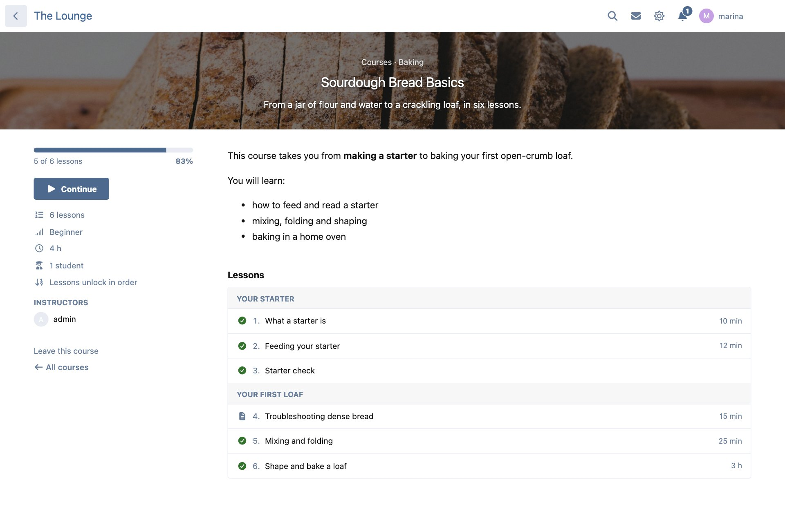
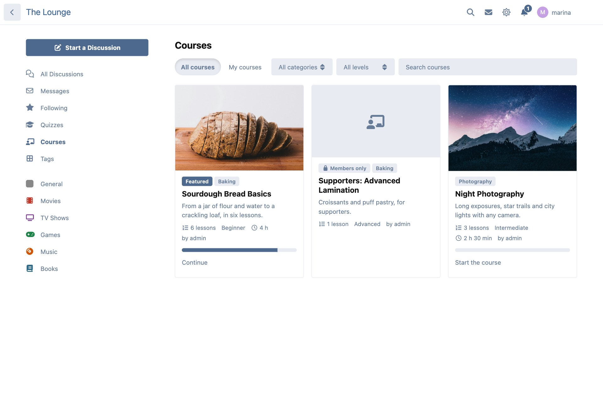
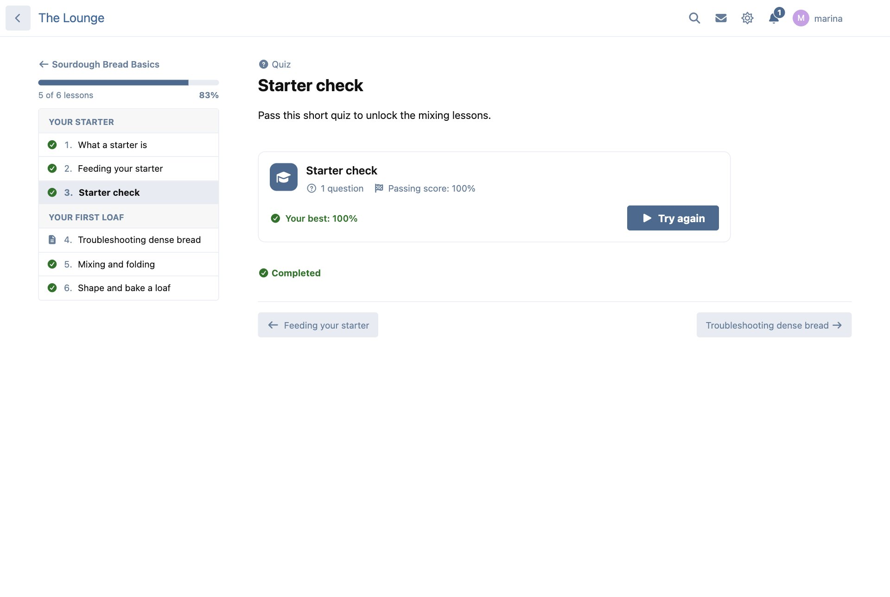
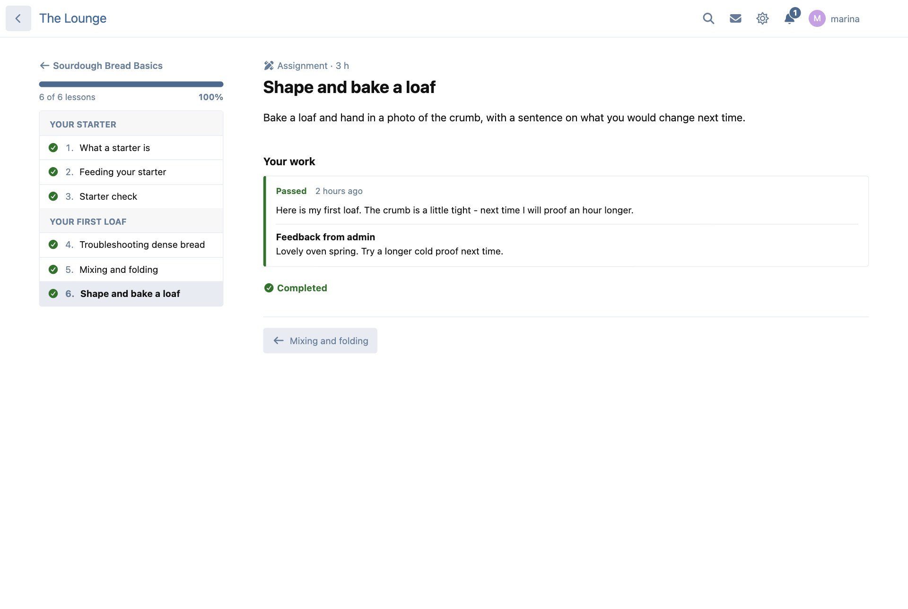
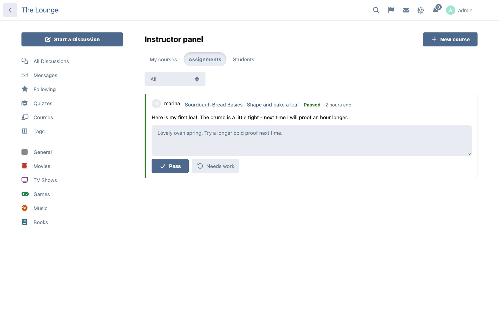
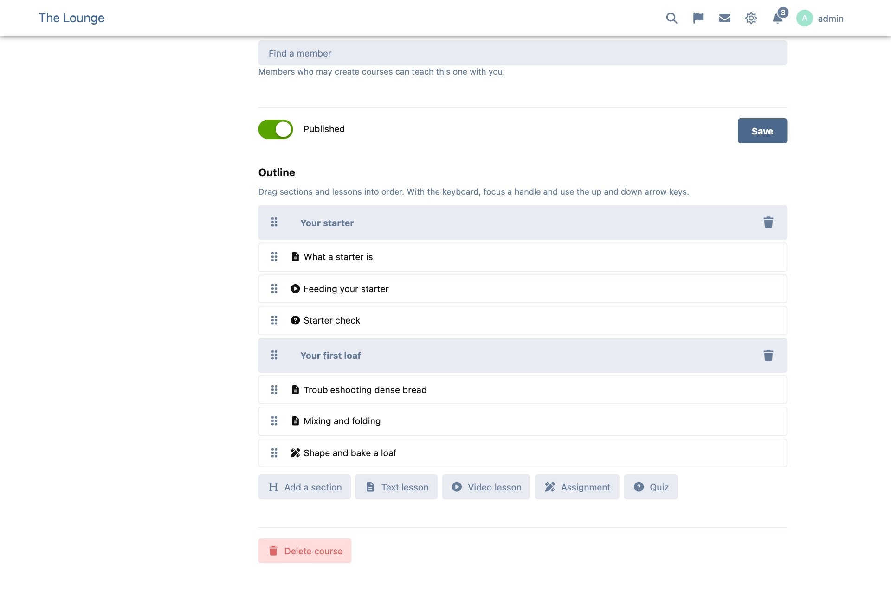
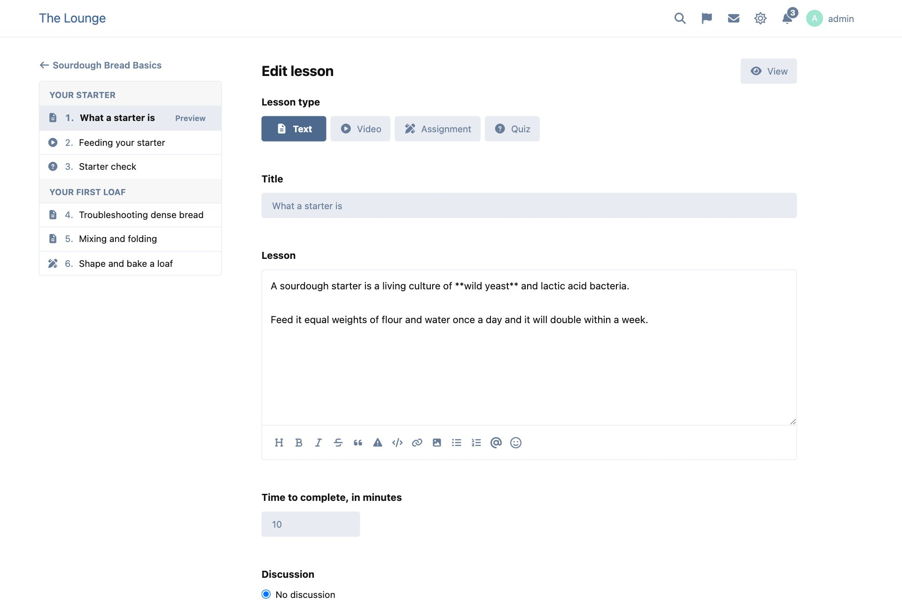
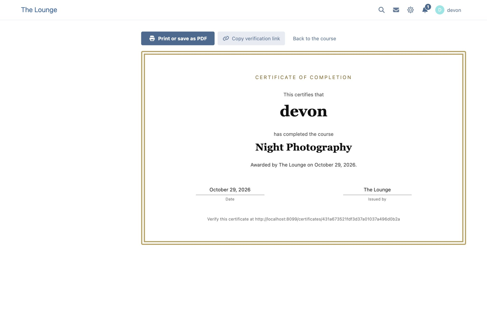
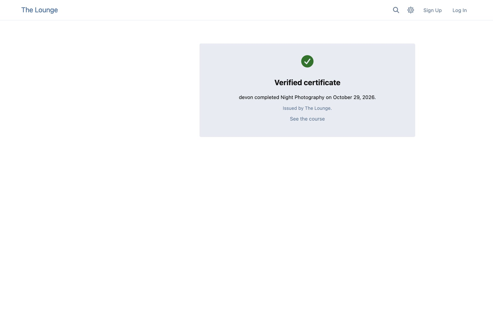
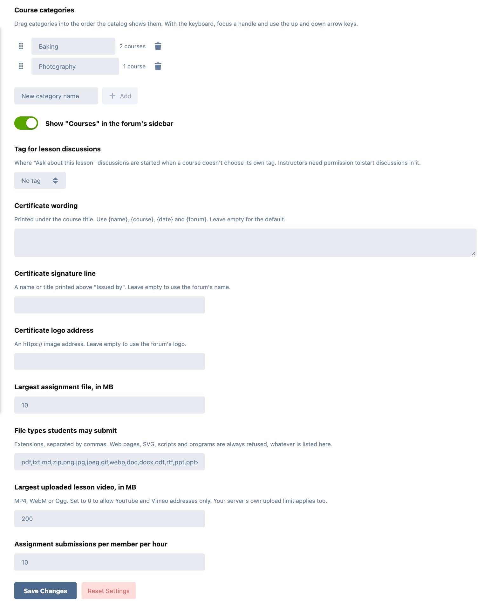

# Syllabus — courses for Flarum

 

Teach inside your community. Build a course out of text, video, assignment and quiz lessons, let members enroll and work through it at their own pace, and give everyone who finishes a certificate they can share. Every lesson can have its own discussion, so questions get answered where the rest of your forum can learn from them too.



## Features

- **Courses with categories.** Each course has a title, a summary, a description written in your forum's own editor, a cover image, a level, an estimated time and a category. You order the categories by dragging them.
- **Four kinds of lesson.** **Text**, written in the forum's editor (Markdown, BBCode, Scribe or FoF Rich Text — whatever your posts use). **Video**, from a YouTube or Vimeo address or an uploaded file, with notes underneath. **Assignment**, where students submit text and files and an instructor passes them or asks for more work. **Quiz**, a [Brainstorm](https://github.com/ernestdefoe/brainstorm) quiz that completes the lesson when it is passed.
- **A drag-and-drop outline.** Group lessons into sections and drag both into order. With the keyboard, focus a handle and use the arrow keys.
- **Enrollment and progress.** Members enroll with one click and mark lessons complete as they go. You can make lessons unlock in order, and let anyone preview the first few. "My courses" shows progress bars and a "Continue" button that goes straight back to the lesson they were on.
- **A discussion for every lesson.** Start one automatically when the lesson is published, or link one that already exists. Students see an "Ask about this lesson" box that opens it.
- **Certificates.** Finishing a course issues a printable certificate — print it or save it as a PDF from the browser — with the member's name, the course, the date and your forum's logo. Each one has a public verification link that anyone can open to check it is genuine.
- **An instructor panel on the forum.** Instructors manage their own courses, review assignments, see each student's progress and, with Brainstorm, quiz results — without any admin access. They can add co-instructors.
- **Paid and members-only courses** through groups (see below).
- **Notifications** in the bell and by email, each one something members can turn off: an assignment was reviewed, a new lesson is out, a course is complete, and (for instructors) a student handed something in.
- **A profile tab** listing what a member is taking and has completed, unless they choose to keep it private.
- **A widget** — "Continue learning" for members, "Featured courses" for everyone else — for [Bespoke](https://ernestdefoe.online) and [FoF Forum Widgets](https://github.com/FriendsOfFlarum/forum-widgets-core). In FoF Forum Widgets, drag it into a section of the layout editor; it shows nowhere until you do.
- **A badge** from [FoF Badges](https://github.com/FriendsOfFlarum/badges) when someone completes a course, if you want one.
- Translatable throughout, works in light and dark mode, and adds about 4.5 KB (gzipped) to the JavaScript every page loads. Every Syllabus page loads only when it is opened.

## Screenshots

| The catalog | A lesson with a Brainstorm quiz |
| --- | --- |
|  |  |

| Handing in an assignment | Reviewing it in the instructor panel |
| --- | --- |
|  |  |

| Dragging the outline into order | Writing a lesson |
| --- | --- |
|  |  |

| The certificate | What someone checking it sees |
| --- | --- |
|  |  |

<sub>Cover photos in the screenshots are from Unsplash.</sub>

## Installation

```sh
composer require ernestdefoe/syllabus
```

Then enable **Syllabus** in the admin panel. "Courses" appears in the forum's sidebar.

For quiz lessons, install and enable Brainstorm too:

```sh
composer require ernestdefoe/brainstorm
```

## Updating

```sh
composer update ernestdefoe/syllabus
php flarum migrate
php flarum cache:clear
```

## Permissions

| Permission | Default | What it allows |
| --- | --- | --- |
| View courses | Everyone, guests included | Browse the catalog, read course pages and any free preview lessons. Take it away from guests to keep courses for members. |
| Enroll in courses | Members | Enroll, read lessons, submit assignments and earn certificates. |
| Create and teach courses | Moderators | The instructor panel: create courses and manage your own (and the ones you were added to as a co-instructor). Give it to an "Instructors" group to let members teach. |
| Manage all courses | Moderators | Edit, review and delete any course, feature courses on the catalog, and attach badges. |

Instructors can only edit their own courses. Reviewing a course's assignments and seeing its students is for that course's instructors and for managers.

## Paid and members-only courses

Each course is open either to **everyone who may enroll**, or **only to members of the groups you choose**. That second setting is how paid courses work: anything that adds a member to a group when they pay unlocks the course for them, and taking them out of the group locks it again (their progress is kept in case they come back).

So to sell a course:

1. Create a group, for example "Bakery Club".
2. Sell membership of that group with whatever you already use — a subscription or payment extension, [Client Area](https://ernestdefoe.online), or adding members by hand.
3. In the course's settings, choose **Only members of these groups** and tick "Bakery Club".

Everyone can still see the course page, so it works as the sales page. Set **Free preview lessons** to let people try the first lesson or two before they buy.

## Brainstorm quizzes

With [Brainstorm](https://github.com/ernestdefoe/brainstorm) enabled, the lesson editor offers a **Quiz** lesson. Pick one of the quizzes you can edit in Brainstorm; it shows inside the lesson, ready to play. Passing it — in the lesson or on the quiz's own page — completes the lesson, and in a course that unlocks in order, opens the next one. A quiz passed before enrolling counts too. Instructors see how many of their students passed each quiz in the instructor panel.

Without Brainstorm the Quiz type simply isn't offered. If you switch Brainstorm off later, quiz lessons are hidden and stop counting toward progress until you switch it back on.

## Settings

In the admin panel, under Syllabus:



- **Course categories** — add, rename, delete and drag into order.
- **Show "Courses" in the sidebar.**
- **Tag for lesson discussions** — where "Ask about this lesson" discussions start, unless a course picks its own. Instructors need permission to start discussions there.
- **Certificate wording, signature line and logo.** The wording can use `{name}`, `{course}`, `{date}` and `{forum}`. Without a logo address the forum's logo is used.
- **Uploads** — the largest assignment file, which file types students may submit, the largest lesson video (0 turns video uploads off and leaves YouTube and Vimeo), and how many assignments a member may submit per hour.

## Uploads and privacy

- Cover images are checked, resized and re-saved as WebP, so only the picture itself is kept.
- Lesson videos and assignment files are stored outside your public folder and are only ever sent to people allowed to see them: a video to those who can open its lesson, an assignment file to the student who submitted it and the course's instructors. They are always sent as downloads. Web pages, SVG images, scripts and programs are refused whatever the file name says.
- YouTube videos play from `youtube-nocookie.com`, Vimeo videos with "do not track".
- A certificate's verification link contains a long random code. It shows the member's name, the course and the date — nothing else.

## Troubleshooting

- **Uploads fail for big videos.** Your server has its own limits: raise PHP's `upload_max_filesize` and `post_max_size`, and `client_max_body_size` if you use nginx.
- **"The lesson was saved, but its discussion couldn't be started".** The instructor isn't allowed to start discussions in the chosen tag, or the tag needs approval. Choose another tag, or link an existing discussion instead.
- **A quiz lesson doesn't complete.** Check that the student passed (not just finished) the quiz, and that the lesson is open to them — in a course that unlocks in order, the lessons before it come first. Practice runs by a quiz's own authors never count. Opening the lesson again re-checks.
- **The widget doesn't show in FoF Forum Widgets.** It is opt-in: open FoF's layout editor, drag "Courses" into a section and save.
- **The certificate prints with the forum around it.** Use your browser's print dialog from the certificate page; Syllabus hides everything but the certificate. Turn on "Background graphics" to keep the border.

## Links

- [Source code](https://github.com/ernestdefoe/syllabus)
- [Report a problem](https://github.com/ernestdefoe/syllabus/issues)
- [Buy me a coffee](https://buymeacoffee.com/ernestdefoe) ☕
